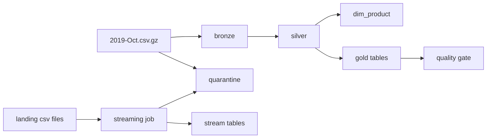

# cartline

[](https://github.com/adwitiyashukla/cartline/actions/workflows/ci.yml)

A Spark ETL pipeline over a real e-commerce clickstream. It takes the October 2019 file of the REES46 multi category store dataset, 42.4 million events, and turns it into a small lakehouse: a raw bronze layer, a cleaned silver layer, an SCD2 product dimension and seven gold tables for sessions, funnels, traffic and customers. A Structured Streaming job reuses the same parsing code, and two Airflow DAGs drive the CLI.

I built it to get good at the parts of big data ETL that are easy to get wrong, like idempotent reruns, partition layout, dedup, late data and sessions that cross midnight.

## Pipeline



## Data

[eCommerce behavior data from multi category store](https://www.kaggle.com/datasets/mkechinov/ecommerce-behavior-data-from-multi-category-store) by REES46 on Kaggle. Every row is one event (view, cart or purchase) with the product, category, brand, price, user and session. I use the October 2019 file, 5.67 GB as csv. It has no remove_from_cart events at all, only views, carts and purchases.

## Layers

| Layer | What happens |
|---|---|
| bronze | The csv is parsed with a fixed schema. Rows that break a rule (bad timestamp, unknown event type, missing ids, negative price) go to a quarantine table with the reason. Valid rows are written per source month, at most 2M rows per file. |
| silver | Exact duplicates are dropped and the data is partitioned by event date. |
| dim_product | SCD2 dimension. Each product's first brand, category and price of every day, with a new version whenever one of them changes. |
| gold | fct_session, fct_funnel_daily, fct_product_daily, agg_hourly_traffic, agg_user_rfm, agg_cart_abandonment, agg_abandoned_products |
| quality | 16 checks after every run. Three of them reconcile sessions, the daily funnel and the hourly traffic against silver row for row. |

A gzip file can only be read by one Spark task, so bronze keeps the source order and does no shuffle at all. Shuffling 42 million rows out of a single task spills a lot to disk. Silver needs exactly one shuffle, because duplicates always share an event date, so the dedup runs on the same partitioning that the date layout needs.

Sessions are my own, a new one starts after 30 minutes of no activity, built with a lag and a running sum. Rebuilding gold for one date reads one day on each side, since a session can start before midnight and end after it, and only sessions that start on that date get written back. Every stage overwrites only the partitions it builds, so rerunning a month or a day gives the same result.

## Streaming

The streaming job watches a landing folder of csv files. It uses the same parse and validation code as batch, drops duplicates inside a 2 hour watermark and writes the events plus an hourly traffic table through foreachBatch. Broken rows go to the same quarantine table. It runs with availableNow, and the checkpoint makes a restart skip files it already read.

## Running it

Needs Python 3.11 or newer and Java 17 or newer.

```
python -m venv .venv
.venv\Scripts\pip install -e ".[dev]"
```

Download 2019-Oct.csv from the Kaggle page and save it gzipped as `data/source/2019-Oct.csv.gz`. A plain csv works too if you change `file_pattern` in `config.toml`. Then run the whole thing:

```
.venv\Scripts\python -m cartline.cli pipeline
```

The stages also run one by one (`ingest`, `silver`, `gold`, `quality`), and `silver` and `gold` take `--date` to rebuild single days. `landing` copies a sample of the source into the landing folder and `stream` processes it.

No download needed for a quick try, `generate` writes a fake dataset with the same columns, a Black Friday spike and some broken and duplicated rows. CI runs on that.

On Windows, Spark also needs `winutils.exe` and `hadoop.dll` in `%HADOOP_HOME%\bin`. All settings live in `config.toml` and are checked when it loads.

Airflow does not run on Windows, so the two DAGs only call the CLI. `cartline_ingest` waits for a source file and loads it, and `cartline_daily` backfills October one date at a time with silver, gold and the quality gate.

## Tests

61 pytest tests (4 of them need Airflow installed). The fixtures generate a small dataset and run the full pipeline once. They cover things like a one date rebuild matching a full build, a session crossing midnight staying one session, ingest reruns changing nothing, a stream restart reprocessing nothing and a broken silver table failing the gate.

CI runs ruff and pytest on Python 3.11, 3.12 and 3.13, plus a pipeline job that generates 2M events, runs every stage and the stream, then runs the daily DAG with `airflow dags test`.

## What the data shows

From the October run, every number below checked again with DuckDB.

- 42,448,764 events, 30,220 of them exact duplicates. No row broke a parsing rule.
- 96.13 percent of events are views, 2.12 percent carts and 1.75 percent purchases. The 742,773 purchases add up to 229.9 million in price (the dataset does not say which currency).
- 7,796,425 sessions. A session has 5.44 events and lasts 5.85 minutes on average, and 30.6 percent of them are a single event. The source has 9,244,421 session ids, so it splits activity more finely than a 30 minute gap, and 14.4 percent of my sessions cover more than one of them.
- 7.47 percent of sessions end in a purchase. In 52.05 percent of those buying sessions there is no cart event at all, so most purchases skip the cart. On 15 of the 31 days there are more buying sessions than carting sessions.
- Of the sessions that do add something to the cart, 53.28 percent buy in that same session.
- Electronics brings in 176.4 million, 76.7 percent of all revenue, and converts best at 2.81 percent of views. Of the categories with over 100,000 views, apparel converts worst at 0.52 percent.
- Apple alone is 48.36 percent of revenue and Samsung 20.18 percent.
- 56,762 of 166,794 products (34 percent) changed price, brand or category at least once during the month. One product went through 29 versions.
- 62.14 percent of the 347,118 buyers bought exactly once.
- Purchases peak at 07:00 to 09:00 UTC while browsing peaks later, at 15:00 to 17:00 UTC.
- The busiest day was Sunday October 13 with 1,638,290 events.

## Numbers

Spark 4.2 in local mode on a 2 core Linux box with 7 GB of RAM, each stage as its own command.

| Stage | Time | Output |
|---|---|---|
| ingest | 347 s | 42,448,764 rows in 22 files, 1.5 GB |
| silver | 184 s | 42,418,544 rows, 902 MB |
| gold | 245 s | 8 tables, 299 MB |
| quality | 71 s | 16 of 16 checks passed |
| stream | 33 s | 199,983 sampled events from 8 landing files, all kept |

Inside gold, fct_session takes the longest at 95 s since it sorts every event by user and time. Ingest is the slow stage overall because the gzip file is read by a single task.
